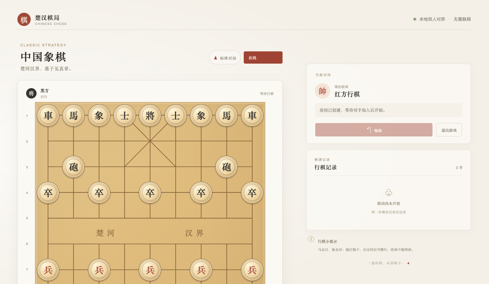
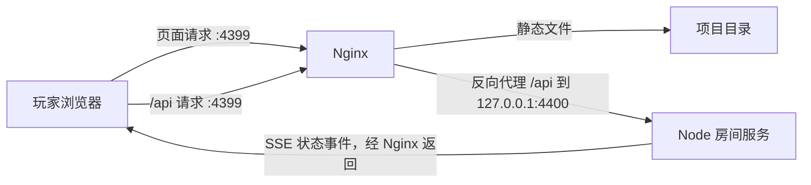

# 楚汉棋局

这是一个由 AI 从零到落地实现的中国象棋项目：从最初的浏览器棋盘、交互修正，到局域网在线对战、Nginx/Node 部署配置和项目文档，均通过与 AI 的多轮沟通逐步完成。项目使用 HTML、CSS 和原生 JavaScript，支持本地双人对弈及局域网在线对战；不依赖外部账号或云服务。

## 项目预览

游戏主页展示棋盘、当前行棋状态、在线房间入口和行棋记录。



*截图中的在线房间号已遮盖。*


## 功能概览

- 本地双人轮流对弈，支持拖动棋子、合法着法提示、棋谱记录和悔棋。
- 局域网房间对战：创建房间后分享房间号或邀请链接，由另一位玩家加入。
- 在线同步棋盘、行棋记录和对局计时；服务端校验在线着法。
- 对局退出后提供 30 秒恢复时间；双方确认后可以重新开始。

## 技术栈

| 部分 | 技术 |
| --- | --- |
| 页面 | HTML、CSS、原生 JavaScript |
| 象棋规则 | 浏览器和 Node.js 共用的 `rules.js` |
| 在线房间服务 | Node.js 内置 HTTP、Crypto 模块 |
| 实时同步 | Server-Sent Events（SSE） |
| Web 服务器和反向代理 | Nginx |

房间及棋局状态暂存在 Node.js 进程内存中，不使用 MySQL、Redis 或第三方服务。Node 服务重启后房间会清除；房间闲置 6 小时后过期，最多同时保存 300 个房间。

## 项目文件

- `index.html`：页面结构。
- `styles.css`、`online.css`：页面和在线对战样式。
- `game.js`：棋盘交互、单机逻辑、房间界面和在线同步。
- `rules.js`：象棋棋盘、走法和将军规则。
- `server.js`：房间 API、服务端着法校验和 SSE 事件服务。
- `nginx/game_1.conf`：Nginx 站点配置示例。
- `docs/images/homepage.png`：README 使用的游戏主页截图。
- `package.json`：Node 服务启动脚本；项目没有额外 npm 依赖。

## 启动环境

需要安装 Node.js 和 Nginx。建议使用仍受支持的 Node.js LTS 版本。由于页面由 Nginx 提供、在线 API 由 Node.js 提供，需要同时运行这两个服务。

### 1. 启动 Node 房间服务

在项目目录运行：

```sh
npm start
```

默认监听 `127.0.0.1:4400`。保持该终端运行。这个 Node 服务只提供 `/api/` 接口，不直接提供网页文件。

如需调整监听地址或端口，可通过环境变量设置：

```sh
GAME_HOST=127.0.0.1 GAME_PORT=4400 npm start
```

如果修改了 `GAME_PORT`，也要同步修改 Nginx 配置中的 `proxy_pass` 端口。

### 2. 配置并启动 Nginx

`nginx/game_1.conf` 是一个 `server` 配置段。将它放入 Nginx 已加载的站点配置目录，或在 Nginx 的 `http` 配置块内添加指向该文件的 `include`。确保该配置的 `root` 指向本项目目录；项目移动后需要相应更新。

当前配置使用以下端口：

- `4399`：浏览器访问端口，Nginx 提供页面并代理 `/api/` 请求。
- `4400`：Node 房间服务端口，仅供本机 Nginx 代理访问。

检查配置并重载 Nginx：

```sh
nginx -t
nginx -s reload
```

按本机 Nginx 安装方式，命令可能需要管理员权限或由服务管理器执行。确认 Nginx 已监听 `4399` 后，打开：

```text
http://127.0.0.1:4399/
```

### 3. 局域网内访问

其他设备使用运行 Nginx 的电脑的局域网 IP 地址访问，例如：

```text
http://192.168.1.20:4399/
```

macOS 可尝试用 `ipconfig getifaddr en0` 查看 Wi-Fi 地址；Linux 可尝试 `hostname -I`。请将示例 IP 换成实际地址，并确保设备处于可互相访问的局域网中、防火墙允许局域网访问 `4399`。

创建房间后，可在房间窗口复制房间号或邀请链接。邀请链接包含房间号，接收者打开后会自动加入该房间。

## Nginx 配置说明

`nginx/game_1.conf` 是站点的 `server` 配置段。它让 Nginx 同时作为静态文件服务器和在线 API 的统一入口：

| 配置 | 作用 |
| --- | --- |
| `listen 4399` | 对浏览器开放网页和 API 的统一端口。 |
| `root /Volumes/Documents/www/game_1` | 静态文件所在目录；移动项目后需更新。 |
| `location /` 与 `try_files` | 直接由 Nginx 返回 `index.html`、脚本和样式文件；找不到的文件返回 404。 |
| `location /api/` 与 `proxy_pass http://127.0.0.1:4400` | 把 `/api/` 请求转发到本机 Node 服务。页面和 API 使用同一来源，浏览器不直接连接 4400。 |
| `Host`、`X-Forwarded-Host` 等请求头 | 将访问主机信息传给 Node，供服务端检查请求来源。 |
| `proxy_http_version 1.1`、`Connection ""` | 保持代理连接适合长时间在线请求。 |
| `proxy_buffering off`、`proxy_cache off` | 关闭代理缓冲和缓存，使 SSE 状态事件及时送达浏览器。 |
| `proxy_read_timeout 1h` | 允许 SSE 长连接在较长时间内保持打开。 |

项目的请求路径如下：



Node 默认只监听 `127.0.0.1:4400`，供同一台机器上的 Nginx 访问；局域网设备只需访问 Nginx 的 `4399` 端口。

## 在线对战流程

1. **创建房间**：红方浏览器向 `POST /api/rooms` 请求房间。Node 生成 6 位房间号和红方令牌，并在内存中保存棋盘及玩家状态。
2. **分享与加入**：玩家可以把房间号发给对手，也可以复制邀请链接。邀请链接只在当前页面地址上附加房间号；打开链接后，浏览器自动调用 `POST /api/rooms/{房间号}/join`。手动输入房间号使用同一个加入接口。成功后加入者为黑方；房间不存在或黑方席位已占用时，页面提示错误并保持本地初始棋盘。
3. **连接并同步状态**：每个玩家用自己的房间令牌连接 `GET /api/rooms/{房间号}/events`。Node 通过 SSE 将房间状态分别推送给双方；两边连接就绪后开始计时。浏览器断线时，EventSource 会尝试重连，页面也会用当前浏览器保存的房间令牌恢复状态。
4. **行棋**：当前行棋方将起点、落点、令牌和棋局版本发送到 `POST /api/rooms/{房间号}/move`。Node 检查令牌、行棋顺序、版本及象棋合法走法，接受后更新权威棋盘并通过 SSE 推送给双方。浏览器本地显示的是服务端确认后的状态。
5. **退出与重开**：退出请求会暂停棋盘并广播 30 秒恢复倒计时。任一方再次进入会取消倒计时并继续原局；任一方离开或倒计时结束，Node 关闭房间并通知双方返回初始界面。对局结束后，双方分别确认“重新开始”，Node 才会建立新一局。

房间令牌用于确认玩家身份，只保存在各自浏览器的 `sessionStorage`，不会放进邀请链接。房间号用于找到房间并占用尚空的黑方席位。

## 隐私与数据

棋局和房间数据保存在运行 Node 服务的本机内存中，不会写入 MySQL 或 Redis，也不会发送到第三方服务。房间令牌保存在玩家当前浏览器的 `sessionStorage` 中；邀请链接只含房间号，不含令牌。房间号可用于加入尚未被占用的黑方席位。

## 用 AI 复刻类似项目

可以把下面的提示词交给 AI 编程助手，再根据开发过程逐步追加交互和部署需求：

```text
请在当前项目中从零实现一个中国象棋网页游戏，使用 HTML、CSS 和原生 JavaScript。

先检查项目结构和约束，只在指定项目目录内读取和修改文件。实现本地双人对弈、合法走法判断、拖动棋子落点、非法落点回原位、棋谱和悔棋。界面要适配桌面和手机。

随后加入局域网双人在线对战：采用 Node.js 房间服务和 Nginx 反向代理，提供创建房间、房间号加入、邀请链接加入、状态实时同步、服务端着法校验、断线恢复、退出恢复倒计时，以及双方确认后重新开始。优先选择不依赖数据库和外部服务的实现，并说明房间状态存储和隐私边界。

按实际代码整理 README，说明项目用途、技术栈、本地启动步骤、服务器/Nginx 配置和在线流程。实现过程中先阅读现有文件、按阶段落地功能，并在每轮结束时说明改动和验证方式。
```

## 本项目沟通记录

以下按功能阶段简要记录了从需求到交付的沟通，方便了解 AI 如何逐步完成项目：

| 阶段 | 沟通内容与落地结果 |
| --- | --- |
| 项目起步 | 提出在项目目录内用 JS、HTML、CSS 实现象棋，并强调隐私和目录边界；据此建立页面、棋盘与规则逻辑。 |
| 棋子操作 | 指出棋子拿起后无法落子；确定按住拖动、松手落子，合法位置接收，错误位置回原位。 |
| 在线方案 | 讨论本机 PHP、Nginx、Node、Redis、MySQL 环境及 LAN 需求；确定用 Node 内存房间、SSE 同步和 Nginx 反代，外部访问端口为 `4399`，不接入数据库。 |
| 房间体验 | 要求创建房间和加入房间分开，创建者不能误把自己加入另一方；加入成功应明确反馈。随后加入双方就绪后关闭弹窗、“游戏开始”动画及棋盘计时。 |
| 退出与重开 | 明确退出和重新开始是不同操作，重新开始需双方确认；退出则双方棋盘置灰并显示 30 秒倒计时，提供“再次进入”和“离开”，恢复会继续原局，离开或超时则双方回初始界面。 |
| 邀请链接 | 增加可直接打开并加入房间的分享链接，复用房间号加入流程；房间不存在或席位已被占用时提示错误并保留初始棋盘。 |
| 文档整理 | 要求 README 说明项目用途、技术栈、本地启动、Nginx 配置和在线流程，并加入主页截图；截图中的房间号已遮盖。 |
| GitHub 准备 | 讨论英文项目名，采用 `Xiangqi`；说明 GitHub HTTPS 推送应使用个人访问令牌或 SSH，而不是账户密码。 |
